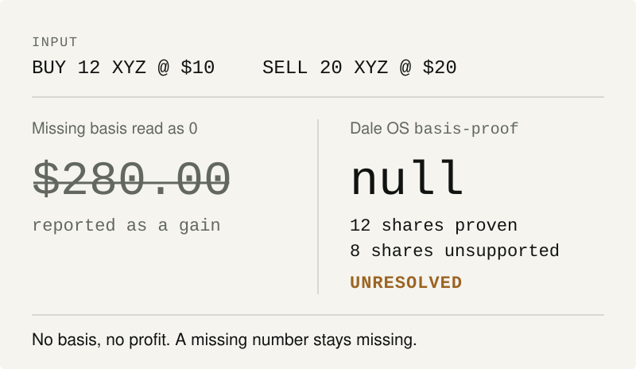

# Dale OS

**Skills, deterministic checks and evals for AI agents doing high-stakes software and financial work.**

[](https://github.com/SVRN-AGNT/Dale-OS/actions/workflows/validate.yml)
[](https://github.com/SVRN-AGNT/Dale-OS/releases)
[](LICENSE)

The rules come from real failures: an agent that fixed a symptom, reopened a settled decision, called a PR "shipped", or produced a clean-looking number from dirty records. Sanitized incidents are in [`cases/`](cases/).

<picture>
  <source media="(prefers-color-scheme: dark)" srcset="docs/assets/basis-proof-dark.svg">
  
</picture>

<details>
<summary>Run it yourself</summary>

```bash
echo '{"method":"FIFO","events":[
  {"id":"b1","type":"BUY","ticker":"XYZ","account_id":"A","date":"2026-01-01","shares":12,"price":10},
  {"id":"s1","type":"SELL","ticker":"XYZ","account_id":"A","date":"2026-02-01","shares":20,"price":20}]}' \
  | python3 tools/basis_proof.py
```

The disposal comes back `UNVERIFIED_OVERSOLD` with `"realized_gain": null`, and the run is `UNRESOLVED`. Python 3 only, no dependencies.

</details>

## What it catches

| Failure | What Dale OS does | Evidence |
|---|---|---|
| A tool turns a missing cost basis into 0 and reports `PASS` | `ledger_delta` returns an unknown delta and `UNRESOLVED` | Caught in our own tool by [mutation-tested invariants](evals/invariants/) ([changelog](CHANGELOG.md)) |
| An agent is told to skip a rule, and does | The skill fires on the pressure itself | Held-out prompts: 18 of 21 pass with the plugins, 7 of 21 without ([proof](PROOF.md)) |
| One reviewer passes a PR with real problems | A second model from another vendor reviews authority work before merge | Codex flagged a P1 on 43 of 103 PRs Claude's reviewer had passed ([record](docs/reports/SECOND_VENDOR_RECORD_2026-10-25.md)) |
| Deposits get counted as investment return | `performance-truth` withholds the return when flow timing is missing | [`cases/funding-is-not-performance.md`](cases/funding-is-not-performance.md) |

What these numbers don't show yet: the 43 PRs show that the two reviewers disagree, not that every flag was a real bug, and the held-out prompts were written by the same author. Method and limits are in [`PROOF.md`](PROOF.md).

## Install

In Claude Code (two plugins, so you load only the half you need):

```text
/plugin install dale-os-operator --marketplace SVRN-AGNT/Dale-OS
/plugin install dale-os-financial-truth --marketplace SVRN-AGNT/Dale-OS
```

Any Agent Skills host (Codex, Cursor, and others): `npx skills add SVRN-AGNT/Dale-OS`, or one skill at a time with `gh skill install SVRN-AGNT/Dale-OS <skill>`. Pinning and preview-before-install are in [INSTALL.md](INSTALL.md).

**If you are an agent:** read [`AGENTS.md`](AGENTS.md). If you already know what is broken, start with `machine/failure-classes.json`. If the work spans multiple failure classes, use `machine/compositions.json`. Do not load the whole repo.

**Read next:** [The Shipping System](shipping/README.md) · [Harness map](docs/HARNESS_MAP.md) · [Advanced agentic engineering](docs/AGENTIC_ENGINEERING.md) · [Try to break it](CHALLENGE.md) · [Read the proof](PROOF.md) · [Browse the library](docs/LIBRARY.md) · [Skill catalog](docs/SKILL_CATALOG.md)

## Why it exists

**Authority before autonomy. Evidence before confidence. Real fixes to real problems.**

Dale OS is a portable control plane for AI agents doing consequential software and financial work. It turns recurring failure modes into small falsifiable skills, deterministic checks, narrow compositions, machine-readable receipts, and reproducible evals.

I did not start this as a framework. I kept running into the same expensive failure modes while building real software: agents fixing symptoms instead of mechanisms, reopening decisions I had already made, wandering outside scope, calling a PR "shipped," or producing a financially clean-looking number from dirty underlying records.

So I started turning the lessons into rules. Dale OS is the result.

- **Authority before autonomy.**
- **Real fixes to real problems.**
- **Null is not failure. False certainty is.**
- **Get the money right.**

This repository is the canonical source. Skills are modules inside the operating system. Deterministic tools handle math and reconciliation where reasoning alone is not good enough. Evals try to break the rules before real work does.

## The Shipping System

**Agents review and merge each other's work; people keep only the steps that are theirs.**

[`shipping/`](shipping/README.md) packages the review-and-merge pipeline assembled in one day for a private financial repository, around the merge controller it already had. Each change gets a lane from the paths it touches: docs, ordinary, truth, or held. The lane decides who judges it (an independent agent reviewer on every PR, plus a second model from a different vendor on authority work) and how it lands (one Controller for everything, with held scope released only through a merge gate that re-derives the second vendor's clearance at merge time). Production releases, access grants and any widening of a reviewer's authority stay with a person.

- [Operating model](shipping/README.md): roles, lanes, the 16 rules that make it hold, and what stays human.
- [Before and after](shipping/FLOW.md): every stage, with merged versus pending and measured versus expected.
- [Sourced playbook](shipping/PLAYBOOK.md): Anthropic's own guidance, primary sources only, mapped to each rule.
- [Adoption guide](shipping/ADOPT.md): twelve steps in four levels, so any repository can join, plus [templates](shipping/templates/).
- [`shipping-lanes`](skills/operator/shipping-lanes/SKILL.md): the same rule as a skill an agent can load.

## Developer quickstart

If you want the fastest technical read, inspect these in order:

1. [`skills/operator/swarm/SKILL.md`](skills/operator/swarm/SKILL.md) — the adaptive multi-agent harness.
2. [`docs/AGENTIC_ENGINEERING.md`](docs/AGENTIC_ENGINEERING.md) — the graph, authority, handoff, and control-plane architecture behind it.
3. [`machine/failure-classes.json`](machine/failure-classes.json) and [`machine/compositions.json`](machine/compositions.json) — low-context routing and narrow composition.
4. [`examples/swarm-harness.md`](examples/swarm-harness.md) — a worked example of decomposing a real agent-loop failure.
5. [`CHALLENGE.md`](CHALLENGE.md) and [`PROOF.md`](PROOF.md) — how the claims are attacked instead of merely asserted.

From a checkout:

```bash
python scripts/verify.py
# add Node 24 / Eve adapter verification:
python scripts/verify.py --with-eve
```

## Two systems, one philosophy

### Operator OS

For coding agents and agentic software work:

- `execution-charter` — give the agent a fence before a shovel.
- `systemic-bug-instinct` — assume a bug may be systemic until the blast-radius audit says otherwise.
- `truth-boundary` — separate known, derived, estimated, inferred and unknown.
- `latest-authority` — carry the latest human decision forward; do not re-ask it without new conflicting evidence.
- `diff-scope-audit` — every hunk owes the charter an explanation.
- `protected-boundary` — stopping is a valid successful action.
- `intent-drift-check` — busy is not the same as aligned.
- `operator-ui-audit` — a wrong value in the UI is usually a data problem wearing a costume.
- `swarm` — design the smallest task-specific multi-agent harness; expand and prune on evidence.
- `reachability-proof` — a guard nothing reaches is not a guard; silence is not evidence of health.
- `loop-closure` — capture is not the problem, retirement is; report net loops.
- `false-competence-check` — the most expensive mistakes look like good work.
- `risk-kernel` — instructions are not boundaries; make the forbidden unexpressible.
- `verify-before-cite` — memory is a lead, not a fact; verify work state before citing it.
- `memory-promotion` — the inbox can be messy, memory cannot be; remember less, better.
- `completion-contract` — "done" is a verdict, not a report; the worker does not deliver it.
- `merge-authority` — evidence authorises only the tree it judged; permission cannot come from the party asking.
- `seam-audit` — each side can be right while the system is wrong; audit the join.
- `shipping-lanes` — risk picks the lane; the lane picks the judge and the lander.

### Advanced agentic engineering

For hard software work that exceeds a single-agent loop, Dale OS also documents the harness layer: adaptive task graphs, authority graphs, state-authority topology, independent falsification, durable worker/reviewer loops, evidence/control separation, exact-SHA handoffs, recovery, and write-topology rules. See [`docs/AGENTIC_ENGINEERING.md`](docs/AGENTIC_ENGINEERING.md).

The central shift is from **prompt engineering** to **environment engineering**: shape what agents can see, what they are allowed to decide, how they prove progress, how they hand off, and what makes completion valid.

### Financial Truth

For money, ledgers, portfolio analytics and financial models:

- `money-trail` — every dollar gets a passport.
- `accounting-integrity` — well-formed data can still lie.
- `performance-truth` — funding is not performance.
- `basis-proof` — no basis, no profit.
- `ledger-repair` — preview the economics before changing the books.
- `transfer-neutrality` — money does not teleport.
- `cash-truth` — missing cash is not zero cash.
- `financial-evidence-grade` — an estimate is not an authority.
- `tax-character-proof` — observed cash and tax character are different facts.
- `corporate-action-continuity` — identity can change without changing economics.
- `model-sanity` — a plausible model is not automatically a valid model.
- `close-the-books` — do not publish analytics whose required books are not ready.

## Five-minute proof

```bash
python scripts/verify.py   # run first: builds the generated adapters, then validates
python scripts/dale.py catalog
python scripts/dale.py resolve symptom-patch --json
python scripts/dale.py compositions --json
python scripts/dale.py challenge
python scripts/dale.py doctor
```

The repo ships a machine-readable receipt contract in [`RECEIPTS.md`](RECEIPTS.md) and `schemas/receipt.schema.json`, so agent handoffs can preserve claims, unknowns, mutations and verification instead of forwarding confidence without evidence.

## Repository map

```text
Dale-OS/
├── README.md                # human entry point
├── AGENTS.md                # machine-first entry point
├── INSTALL.md               # preview/install/update paths
├── PRINCIPLES.md            # operating floor
├── ARCHITECTURE.md          # dependency and authority model
├── skills/                  # canonical Agent Skills modules
│   ├── operator/
│   └── financial-truth/
├── shipping/                # the Shipping System: model, flow, playbook, adoption
├── ci/                      # shared CI layer other repositories call
├── tools/                   # deterministic, read-only financial checks
├── evals/                   # activation, behavior, composition, fixtures
├── plugin-evals/            # activation, behavioral, held-out and sample-repo plugin eval cases
├── cases/                   # sanitized incidents that paid for rules
├── machine/                 # routing, composition, discovery contracts
├── adapters/                # host-specific distributions/guidance
├── scripts/                 # control surface, generators, validators
├── schemas/                 # portable machine contracts
├── release/                 # machine-readable release authority
└── docs/                    # deeper operating and evaluation contracts
```

For detailed navigation, see [`llms.txt`](llms.txt) or [`AGENTS.md`](AGENTS.md).

## Source rule

**One source. Many adapters.**

The canonical skill lives in `skills/**/SKILL.md`. Platform adapters are generated from that source. Never hand-maintain a second copy of a rule just because a different agent framework wants a different filesystem shape.

## Financial safety rule

Dale OS does not let an LLM become the accounting authority just because it can write a convincing explanation.

When evidence cannot establish the answer, the correct output may be:

```text
WITHHELD
Reason: evidence insufficient
```

That is not the system failing. That is the system working.

## Status

**Current tree: 0.2.0-dev.** Since v0.1.0 it adds eleven skills (31 in all, including `swarm`), the agentic-engineering layer, two Claude Code plugins, the shared CI layer and the Shipping System.

**Frozen public release evidence: v0.1.0.** That release closed clean-runner validation, privacy scanning, 20/20 skill installability, generated-source parity, four-model provider-backed evaluation, semantic review, and targeted remediation. The historical four-model baseline remains **78/80 semantic passes (97.5%) with 0 critical invariant violations**; it is not rewritten to include post-v0.1 capabilities.

The eleven post-v0.1 skills have their own activation and behavioral coverage in the current tree, but none is claimed as part of the frozen v0.1.0 provider-backed matrix.

See [`PROOF.md`](PROOF.md), [`docs/reports/CROSS_MODEL_VERIFICATION_2026-08-07.md`](docs/reports/CROSS_MODEL_VERIFICATION_2026-08-07.md), and [`docs/PUBLIC_RELEASE_READINESS.md`](docs/PUBLIC_RELEASE_READINESS.md).

## Why “Dale OS”?

Dale OS is partly what happens when one messy human tries to run a small institution out of one skull. Dale is a solopreneur juggling finance, software, product, research, QA, and the organizational chaos between them while trying to build financial software with institutional-style discipline. The brain is useful; the queue is not. Dale OS externalizes the operating rules so AI can absorb more of that complexity **without amplifying the chaos**.

Designed and curated by Dale Powell from real human-agent operating experience while building ACF Dashboard and related systems. The public package is intentionally generalized: ACF-specific scoring logic, personal financial data and proprietary product internals do not belong here.
