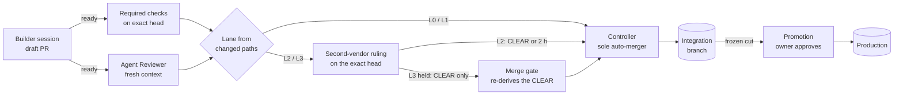

# The Shipping System

**How agent-written changes get reviewed, merged and released without the owner in the routine loop.**

> Risk picks the lane. The lane decides who judges and who lands. People keep only the steps that are theirs.

Assembled on 14 October 2026 in a private financial dashboard repository, around the merge controller and held-scope rules it already had, then packaged here so any repository can adopt it. Everything below says whether it is merged, still pending, measured or only expected.

[Operating model](#the-operating-model) · [Before and after](FLOW.md) · [Sourced playbook](PLAYBOOK.md) · [Adopt it in a repo](ADOPT.md) · [Templates](templates/) · [Skill: `shipping-lanes`](../skills/operator/shipping-lanes/SKILL.md) · [Shared CI layer](../ci/README.md)

## The problem it solves

Before, the owner was the merge loop. Agents could write code quickly, but:

- review happened only when someone remembered to ask for it, and on one day nobody did;
- a check could be labelled blocking and still be unable to stop a merge;
- a red nightly run told nobody;
- held changes waited for the owner, and every merge restarted an hour-long release suite, so one release stayed open for 3 h 55 min;
- a planned auto-fixer would have pushed under the owner's own account, limited only by an instruction.

The aim is not to remove people. It is to move them to the steps that need a person: releasing to production, granting access, and deciding when an automated judge has earned more authority.

## The operating model

### Roles

| Role | Who | Does | Never does |
|---|---|---|---|
| **Builder** | A Claude session | Writes the change on its own branch, verifies locally, opens a draft PR, marks it ready | Merge, approve itself, edit its own judge |
| **Agent Reviewer** | A fresh Claude instance in CI | Reads the diff at the exact head commit and posts a typed verdict as a check run, with each blocking finding quoting the line it cites | Push, merge, approve held scope |
| **Second-vendor reviewer** | A model from a different vendor (here, Codex on the owner's ChatGPT plan, read by a "PM" workflow) | Gives a second opinion on authority work (truth and held lanes) once the Builder posts a `HANDOFF:` naming a ready head whose CI and Agent Review are green. The PM posts `CLEAR`, `CORRECT` or `HOLD` as a check on that head | Merge |
| **Controller** | A GitHub workflow (or a merge queue) | The only merger. Merges eligible PRs into the integration branch, one at a time, and held PRs only through the merge gate | Merge held scope without a CLEAR it re-derives itself, promote, deploy |
| **Owner** | A person | Authorises each promotion to production, sets up access once, makes the rulings the gate enforces, stops any PR with an `owner-hold` label | Routine merges, held merges |

### Lanes

A lane is chosen from the paths a change touches, including both sides of a rename. It is never self-declared, because the author most likely to underrate a change is also the one least likely to label it.

| Lane | Typical paths | What it needs to land |
|---|---|---|
| **L0 docs** | `docs/**`, `*.md` only, except authority sources (instruction files such as `CLAUDE.md` and `AGENTS.md`, skills that set gates, owner decisions, merge policy), which are L3 | Required checks + a passing Agent Review |
| **L1 ordinary** | Everything not below | Green required checks on the exact tree + a passing Agent Review |
| **L2 truth** | Money, sync, evidence, imports, identity | L1 + the affected tests + second-vendor CLEAR (or 2-hour timeout) |
| **L3 held** | Workflows, access, billing, migrations, merge and release tooling | L2, but only a **CLEAR** counts, never the timeout. The merge gate re-derives it just before merging |

The lane decides who judges and who lands. It never decides whether the work is correct; the checks and reviewers do that. A path that cannot be classified counts as held.

In the reference repo, "a passing Agent Review" on L0 and L1 is a Builder rule: the Builder sets READY only after the review passes, but the Controller does not read the check on ordinary PRs, and a contract test fails if it starts to. The merge gate requires the pass only on PRs that carry a `HANDOFF:` and on held scope. Making the reviewer a merge gate for ordinary work is the owner's decision, waiting on the measured bar in rule 5.

**The ready rule (owner decisions, 14 to 19 October 2026).** Ordinary work (L0 and L1) needs green CI and a passing Agent Review, and nothing more. For authority work (L2 truth: money, sync, evidence, imports, identity) and held PRs (L3), the Builder marks the PR ready, waits for Agent Review and CI to go green on that head, and then posts one `HANDOFF:` naming it. L2 lands on the second vendor's `CLEAR`, or after 2 hours with no ruling (recorded as "PM timeout"). L3 lands only on a `CLEAR`. A `CORRECT` or `HOLD` blocks the merge, a push revokes every ruling and needs a new HANDOFF, and an Agent Review approval never stands in for a CLEAR. Each Codex ruling is a round: after round 3 the whole PR gets a full Claude review and a check on whether to split it, and round 6 onward needs the owner's word. This replaced two earlier rules: the second vendor on every PR, judged overly cautious, and a CLEAR before ready. The HANDOFF now waits for Agent Review and CI, so the second vendor's limited quota is spent only on a finished change.

### Recognizing a high-stakes PR

The owner set this on 14 October 2026 so a high-stakes PR is recognizable at a glance. L2 and L3 are high stakes; L0 and L1 are ordinary.

- **Every message that mentions a PR ends with one marker line per PR:**
  - `🔴 HIGH STAKES · #NNNN · <action needed>` for L2 or L3
  - `🟢 Ordinary · #NNNN` for L0 or L1
- **A high-stakes PR also carries** a `high-stakes` label and a `[HIGH STAKES]` title prefix, so it stands out in GitHub's own lists.
- The marker comes from the derived lane, never from the author's opinion.

### The flow

### Rules that make it hold

Each rule exists because its absence caused, or nearly caused, a real failure. The mechanism matters more than the wording.

1. **The judge cannot be edited by the change it judges.** The reviewer's workflow and prompt load from the merged base branch. The PR is read as git objects with read-only tools and is never checked out, installed or run.
2. **A verdict covers one commit.** It is posted as a check run on the exact head SHA, and a new push revokes it. Anything short of a clean verdict, including "could not review", counts as not reviewed.
3. **Find, then verify.** A blocking finding must quote the line at head that it is about, or it is dropped. Anthropic's own review tool has the same verification step ([playbook F3](PLAYBOOK.md#f3)).
4. **Correctness only, and re-review converges.** Nits never block. If a push leaves the diff unchanged, the earlier verdict carries over. In the reference repo this compares `git patch-id --verbatim`, because `--stable` ignores whitespace and the reviewer itself found that gap.
5. **Shadow first.** A new reviewer reports and does not block until it clears a written bar: at least 30 PRs, at least 80% precision, at least 4 of 5 planted defects caught, at least 9 of 10 re-runs agreeing, "could not review" on at most 5% of runs, bounded cost and wall time, and at most 1 escape (full bar in [ADOPT step 11](ADOPT.md#step-11--the-reviewer-earns-blocking-power)). Falling below the demotion line returns it to report-only with no decision needed, because that narrows authority.
6. **Two vendors on authority work.** On truth and held lanes, a second opinion from a different vendor has to clear the change before it merges, so approval is never one model agreeing with itself. On the truth lane a 2-hour timeout keeps a quiet reviewer from stalling the line. Held scope has no timeout (the ready rule above). Ordinary work relies on the Agent Review alone.
7. **The review trigger is not the author's choice.** Agent Review runs on every ready PR automatically. The `HANDOFF:` for the second vendor is part of every truth and held PR's checklist, not something the author may skip. See the case [the reviewer nobody called](../cases/the-reviewer-nobody-called.md).
8. **One lander.** Only the Controller merges automatically. No session merges, enables auto-merge or updates branches around it.
9. **Held scope lands through a gate that re-derives the verdict.** No approver yet exists that the automation cannot impersonate (the trusted-reviewer list is empty by design), so a person's approval can't release held scope. Instead the merge gate releases it when the current head has green CI, a passing Agent Review, a `HANDOFF:` naming it, and a PM `CLEAR` that still stands when the gate re-reads Codex's own comments and the head's checks, once at election and again just before the merge call. A finding posted after the CLEAR blocks the merge. An `owner-hold` label stops any PR. (Owner ruling, 16 October 2026: no person types "merge".)
10. **The verdict must outlive the merge call.** Before 16 October, held PRs were merged by hand, and two were merged before the second opinion arrived, which turned the review into a check that ran after the merge. The gate's second read just before the merge call, and its refusal to count the 2-hour timeout on held scope, exist because of that.
11. **Limits live in access, not in prompts.** Any agent that pushes gets its own identity with limits the platform enforces. Until then, the auto-fixer stays paused.
12. **Evidence covers only the tree it judged, and the same tree is never tested twice.** A skip is allowed only when the identical tree is already green.
13. **Red tells someone.** A red scheduled or trunk run opens one issue, which closes itself when the run is green again.
14. **Every model job has caps:** a spend budget, a process timeout, a job timeout and a concurrency group.
15. **A release is frozen at one commit.** Merges keep landing while a promotion runs, and the receipt is generated from git rather than written by hand.
16. **Builders do not refresh the base just to stay current.** Freshness is the Controller's job. A Builder merges the base into its branch only to fix a conflict, to pick up code it needs, or once before a held PR's final `HANDOFF:`, because the lander never updates a held PR (in the reference repo it merges a behind held PR only when the base changed none of its files; the shared merge lane refuses any behind PR). Each refresh is a new head, so the full PR gate runs again. In the reference repo, heads that only merged in the base used 30% of PR CI minutes over 200 runs (973 of 3,279 billed minutes on 13 and 14 October 2026).

### What stays human

| Step | Why it is a person's |
|---|---|
| Authorise each promotion to production (a session performs the merge once the full suite is green), and deploy | It cannot be undone by the time anyone reads about it |
| Create agent identities, rulesets and secrets | It grants access; an agent cannot grant itself access |
| Allow a sixth or later Codex round on one PR | Repeated rounds mean the change needs splitting or rethinking, not another pass |
| Give an automated judge more authority | It changes merge authority; it needs measured evidence first |
| Read production after a deploy | It reads live user data, so it needs a written protocol |

Things the owner no longer does in the reference repo: approve bot runs stuck on "action required", wait while a release suite restarts, be the only check on whether review happened, or notice a red nightly, which now opens an issue. For a promotion, the owner gives a one-off written authorisation for that cut, and a session performs the merge once the full suite is green on it.

## Status on 14 October 2026

These are the states when this page was written. Check the linked PRs for live state.

**Merged and measured**

- In the reference repository, the main instructions file went from 411 to 225 lines, with all 320 moved lines kept word for word in a detail document.
- The slowest test tier went from 6m27s to 1m42s, measured locally and not yet on CI runners. Two files took 78% of its time running a forecast nobody read.
- Agent Review runs on every ready PR. Each review takes about 30 to 60 seconds and costs about $0.15. It is report-only, and it has already caught two confirmed bugs: a check that passed when it should have failed, and a whitespace blind spot in its own convergence logic.
- Acceptance tests are a required check. Mergeability retries back off over 2 to 32 seconds, within a 120-second budget.
- The release-notes bot is removed, and each promotion is frozen at one commit.
- The shared CI layer is in this repository ([Dale-OS #20](https://github.com/SVRN-AGNT/Dale-OS/pull/20)). Its first run found that this repository tested every PR commit twice.

**Also merged later that day:** the real-save-path test for the example module, a faster simulator (2.8× on its own; suite-wide saving not measured), and screenshots on UI PRs with a Friday digest issue.

**Built, not landed:** terse test output for agents (9 lines instead of 2,531), skipping post-merge checks for an already-tested tree, promotion receipts generated from git, and adoption of the shared layer in two more repositories.

**Waiting on a one-time setup from the owner:** the agents' own GitHub App and ruleset, a production test account, and one deny rule in settings.

**Expected, not yet measured end to end:** ready-to-merged time on an un-updated PR from about 13 minutes (the measured median over 22 PRs) down to about 6 to 8 minutes, and about 11 runner-minutes saved per merge from skipping already-tested trees.

**The cost of the day's speed:** held-scope PRs merged by hand carry no Controller attestation, so the next release has to run in full consolidation mode.

**Landed since (14 to 24 October 2026).** Everything under "Built, not landed" merged on 14 October: terse agent test output, skipping post-merge checks for an already-tested tree, promotion receipts generated from git, and adoption of the shared layer in two more repositories. The red-run alert was adopted the same day. The reference repo also gained a truth-clearance gate (see [the harness map](../docs/HARNESS_MAP.md)). Held scope no longer waits for a person: the merge gate described in rule 9 lands it ([`ci/README.md`](../ci/README.md#the-merge-lane-caller)), and this repository runs it on itself. On PRs with a HANDOFF and on held scope, a passing Agent Review is one of the gate's conditions; on ordinary PRs it is still a Builder rule (see the lanes above). The second vendor runs as Codex on the owner's ChatGPT plan, with no API key, and each ruling counts against a round budget. The gate's threat model, including what it does not defend against, is in the same section of `ci/README.md`.

## How it relates to the Operating Manual

The owner's Operating Manual (`manual/OPERATING-MANUAL.md` in the owner's private vault repository in the SVRN-AGNT org) covers who decides. This section covers how code moves once a decision is made.

## Where the pieces live

| Piece | Where |
|---|---|
| Shared CI floor and red-run alert | [`ci/`](../ci/README.md) and `.github/workflows/ci-*.yml` in this repo |
| The rule, as an agent skill | [`skills/operator/shipping-lanes`](../skills/operator/shipping-lanes/SKILL.md) |
| Adoption guide, one step at a time | [`ADOPT.md`](ADOPT.md) |
| Reviewer rubric, HANDOFF comment, lane map, PR header | [`templates/`](templates/) |
| What changed, stage by stage | [`FLOW.md`](FLOW.md) |
| The Anthropic sources behind each choice | [`PLAYBOOK.md`](PLAYBOOK.md) |
| Reference implementation (private repo) | `.github/workflows/agent-review.yml`, `scripts/agent-review/`, `scripts/lib/reviewAuthority.mjs`, `docs/SHIPPING_LANES_DESIGN_v1.md`, `docs/AGENT_REVIEW_PROMOTION.md` |

Related skills: [`merge-authority`](../skills/operator/merge-authority/SKILL.md) decides whether a specific merge is really authorised. [`completion-contract`](../skills/operator/completion-contract/SKILL.md) keeps the worker from grading its own work. [`risk-kernel`](../skills/operator/risk-kernel/SKILL.md) puts limits into construction. [`reachability-proof`](../skills/operator/reachability-proof/SKILL.md) catches a gate that nothing runs.
