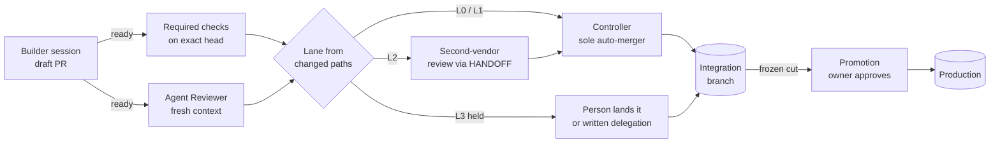

# The Shipping System

**How agent-written changes get reviewed, merged and released without the owner in the routine loop.**

> Risk picks the lane. The lane decides who judges and who lands. People keep only the steps that are theirs.

Assembled on 14 October 2026 in a private financial dashboard repository, around the merge controller and held-scope rules it already had, then packaged here so any repository can adopt it. Everything below says whether it is merged, still pending, measured or only expected.

[Operating model](#the-operating-model) · [Before and after](FLOW.md) · [Sourced playbook](PLAYBOOK.md) · [Adopt it in a repo](ADOPT.md) · [Templates](templates/) · [Skill: `shipping-lanes`](../skills/operator/shipping-lanes/SKILL.md) · [Shared CI layer](../ci/README.md)

## The problem it solves

Before, the owner was the merge loop. Agents could write code quickly, but:

- review happened only when someone remembered to ask for it, and on one day nobody did;
- a check could be labelled blocking and still be unable to stop a merge;
- a red nightly run told nobody;
- held changes waited for the owner, and every merge restarted an hour-long release suite, so one release stayed open for 3 h 55 min;
- a planned auto-fixer would have pushed under the owner's own account, limited only by an instruction.

The aim is not to remove people. It is to move them to the steps that need a person: releasing to production, granting access, and deciding when an automated judge has earned more authority.

## The operating model

### Roles

| Role | Who | Does | Never does |
|---|---|---|---|
| **Builder** | A Claude session | Writes the change on its own branch, verifies locally, opens a draft PR, marks it ready | Merge, approve itself, edit its own judge |
| **Agent Reviewer** | A fresh Claude instance in CI | Reads the diff at the exact head commit and posts a typed verdict as a check run, with each blocking finding quoting the line it cites | Push, merge, approve held scope |
| **Second-vendor reviewer** | A model from a different vendor (here, a ChatGPT "PM" agent) | Gives a second opinion on authority work, when the Builder posts a `HANDOFF:` comment | Merge |
| **Controller** | A GitHub workflow (or a merge queue) | The only automatic merger. Merges eligible PRs into the integration branch, one at a time | Merge held scope, promote, deploy |
| **Owner** | A person | Promotes to production, sets up access once, merges held scope or delegates it in writing, decides when the reviewer may block | Routine merges |

### Lanes

A lane is chosen from the paths a change touches, including both sides of a rename. It is never self-declared, because the author most likely to underrate a change is also the one least likely to label it.

| Lane | Typical paths | What it needs to land |
|---|---|---|
| **L0 docs** | `docs/**`, `*.md` only | Required checks + Agent Review |
| **L1 ordinary** | Everything not below | Green required checks on the exact tree + Agent Review |
| **L2 truth** | Money, sync, evidence, imports, identity | L1 + the affected tests + the second-vendor review |
| **L3 held** | Workflows, access, billing, migrations, merge and release tooling | L2 where it applies, then **a person lands it**. The Controller stops. |

The lane decides who judges and who lands. It never decides whether the work is correct; the checks and reviewers do that.

### The flow

### Rules that make it hold

Each rule exists because its absence caused, or nearly caused, a real failure. The mechanism matters more than the wording.

1. **The judge cannot be edited by the change it judges.** The reviewer's workflow and prompt load from the merged base branch. The PR is read as git objects with read-only tools and is never checked out, installed or run.
2. **A verdict covers one commit.** It is posted as a check run on the exact head SHA, and a new push revokes it. Anything short of a clean verdict, including "could not review", counts as not reviewed.
3. **Find, then verify.** A blocking finding must quote the line at head that it is about, or it is dropped. Anthropic's own review tool has the same verification step ([playbook F3](PLAYBOOK.md#f3)).
4. **Correctness only, and re-review converges.** Nits never block. If a push leaves the diff unchanged, the earlier verdict carries over. In the reference repo this compares `git patch-id --verbatim`, because `--stable` ignores whitespace and the reviewer itself found that gap.
5. **Shadow first.** A new reviewer reports and does not block until it clears a written bar: at least 30 PRs, at least 80% precision, at least 4 of 5 planted defects caught, at least 9 of 10 re-runs agreeing, "could not review" on at most 5% of runs, bounded cost and wall time, and at most 1 escape (full bar in [ADOPT step 11](ADOPT.md#step-11--the-reviewer-earns-blocking-power)). Falling below the demotion line returns it to report-only with no decision needed, because that narrows authority.
6. **Two vendors on authority work.** On L2 and L3 the second opinion comes from a different vendor, so approval is never one model agreeing with itself.
7. **The review trigger is not the author's choice.** Agent Review runs on every ready PR automatically. The `HANDOFF:` for the second vendor is part of the lane's checklist, not something the author may skip. See the case [the reviewer nobody called](../cases/the-reviewer-nobody-called.md).
8. **One lander.** Only the Controller merges automatically. No session merges, enables auto-merge or updates branches around it.
9. **Held scope stops honestly.** If no approver exists that the automation cannot impersonate, held changes stop and a person lands them. When the owner delegates in writing, the merge commit quotes the delegation and says the merge is unattested.
10. **A hand merge waits for the second opinion.** A held PR may be merged by hand only when its current head has green CI, a passing Agent Review, and a `HANDOFF:` that the second-vendor reviewer has answered `CLEAR` for that head, or that has had no ruling for 2 hours. A `CORRECT` or `HOLD` blocks the merge. A push needs a new HANDOFF and restarts the clock. Only the owner naming that specific PR waives the wait; blanket merge approval does not. The merge commit records which path was taken. This came from two held PRs that were merged before the second opinion arrived, which turned it into a check that ran after the merge. (In the reference repo this rule is proposed in an open PR, not yet merged.)
11. **Limits live in access, not in prompts.** Any agent that pushes gets its own identity with limits the platform enforces. Until then, the auto-fixer stays paused.
12. **Evidence covers only the tree it judged, and the same tree is never tested twice.** A skip is allowed only when the identical tree is already green.
13. **Red tells someone.** A red scheduled or trunk run opens one issue, which closes itself when the run is green again.
14. **Every model job has caps:** a spend budget, a process timeout, a job timeout and a concurrency group.
15. **A release is frozen at one commit.** Merges keep landing while a promotion runs, and the receipt is generated from git rather than written by hand.

### What stays human

| Step | Why it is a person's |
|---|---|
| Promote the integration branch to production, and deploy | It cannot be undone by the time anyone reads about it |
| Create agent identities, rulesets and secrets | It grants access; an agent cannot grant itself access |
| Land held scope (or delegate it in writing) | No approver exists yet that the automation cannot impersonate |
| Make the Agent Reviewer a merge gate | It changes merge authority; it needs measured evidence first |
| Read production after a deploy | It reads live user data, so it needs a written protocol |

Things the owner no longer does in the reference repo: approve bot runs stuck on "action required", wait while a release suite restarts, or be the only check on whether review happened. Once the red-run alert is adopted there (pending), a red nightly will open an issue instead of waiting to be noticed.

## Status on 14 October 2026

These are the states when this page was written. Check the linked PRs for live state.

**Merged and measured**

- In the reference repository, the main instructions file went from 411 to 225 lines, with all 320 moved lines kept word for word in a detail document.
- The slowest test tier went from 6m27s to 1m42s, measured locally and not yet on CI runners. Two files took 78% of its time running a forecast nobody read.
- Agent Review runs on every ready PR. Each review takes about 30 to 60 seconds and costs about $0.15. It is report-only, and it has already caught two confirmed bugs: a check that passed when it should have failed, and a whitespace blind spot in its own convergence logic.
- Acceptance tests are a required check. Mergeability retries back off over 2 to 32 seconds, within a 120-second budget.
- The release-notes bot is removed, and each promotion is frozen at one commit.
- The shared CI layer is in this repository ([Dale-OS #20](https://github.com/Tataku/Dale-OS/pull/20)). Its first run found that this repository tested every PR commit twice.

**Built, not landed:** terse test output for agents (9 lines instead of 2,531), skipping post-merge checks for an already-tested tree, a faster simulator (2.8× on its own, suite-wide saving not measured), promotion receipts generated from git, and adoption of the shared layer in two more repositories.

**Waiting on a one-time setup from the owner:** the agents' own GitHub App and ruleset, a production test account, and one deny rule in settings.

**Expected, not yet measured end to end:** ready-to-merged time on an un-updated PR from about 13 minutes (the measured median over 22 PRs) down to about 6 to 8 minutes, and about 11 runner-minutes saved per merge from skipping already-tested trees.

**The cost of the day's speed:** held-scope PRs merged by hand carry no Controller attestation, so the next release has to run in full consolidation mode.

## How it relates to the Operating Manual

The owner's [Operating Manual](https://github.com/Tataku/chaz-automation/blob/main/manual/OPERATING-MANUAL.md) covers who decides. This section covers how code moves once a decision is made. The manual lives in a private repository, so the link resolves only for people with access.

## Where the pieces live

| Piece | Where |
|---|---|
| Shared CI floor and red-run alert | [`ci/`](../ci/README.md) and `.github/workflows/ci-*.yml` in this repo |
| The rule, as an agent skill | [`skills/operator/shipping-lanes`](../skills/operator/shipping-lanes/SKILL.md) |
| Adoption guide, one step at a time | [`ADOPT.md`](ADOPT.md) |
| Reviewer rubric, HANDOFF comment, lane map, PR header | [`templates/`](templates/) |
| What changed, stage by stage | [`FLOW.md`](FLOW.md) |
| The Anthropic sources behind each choice | [`PLAYBOOK.md`](PLAYBOOK.md) |
| Reference implementation (private repo) | `.github/workflows/agent-review.yml`, `scripts/agent-review/`, `scripts/lib/reviewAuthority.mjs`, `docs/SHIPPING_LANES_DESIGN_v1.md`, `docs/AGENT_REVIEW_PROMOTION.md` |

Related skills: [`merge-authority`](../skills/operator/merge-authority/SKILL.md) decides whether a specific merge is really authorised. [`completion-contract`](../skills/operator/completion-contract/SKILL.md) keeps the worker from grading its own work. [`risk-kernel`](../skills/operator/risk-kernel/SKILL.md) puts limits into construction. [`reachability-proof`](../skills/operator/reachability-proof/SKILL.md) catches a gate that nothing runs.
